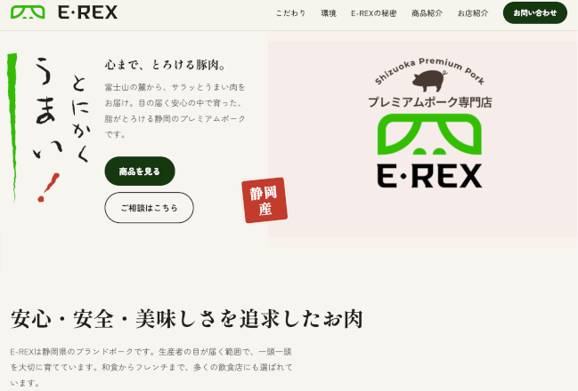

## E-Rex - Premium Japanese Pork

# The website

My goal with this client's site was to incorporate the aesthetics of their previous site but modernized, yet maintain the look and feel familiar to Japanese users. I also wanted to keep it a single HTML file (literally in this case), as I tend to do for simple business-card websites. I only tend to introduce frameworks/libraries such as React and Angular as the apps reach certain complexity. The contact form currently uses a mailto prop that launches the user's default mail app, but I have an API in progress that will allow the contact forms to send proper emails via SMTP. The API will also serve as the backend for the admin portal that the owners of E-Rex and future clients will be able to use to manage the content of their sites.

